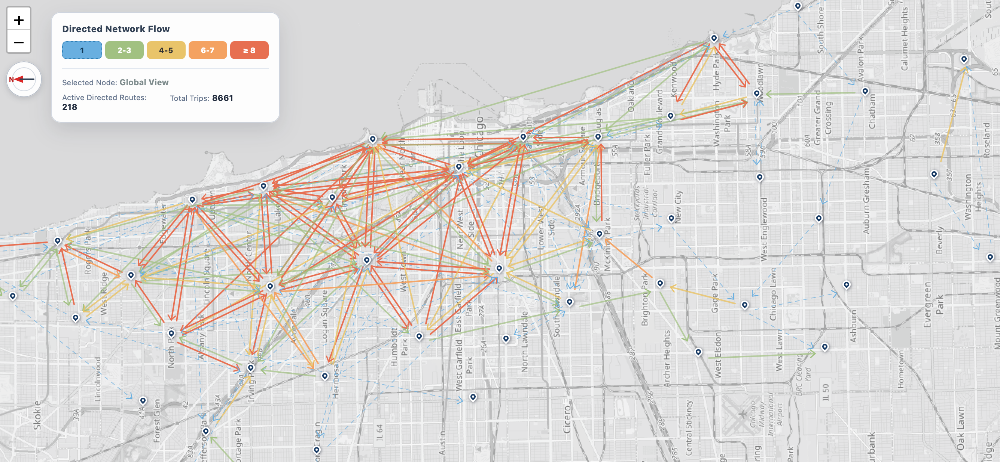

```{r setup, include=FALSE}
knitr::opts_chunk$set(
  echo = FALSE,
  warning = FALSE,
  message = FALSE,
  fig.align = "center",
  out.width = "100%",
  dpi = 150
)

report_dir <- normalizePath(getwd())
data_dir <- normalizePath(file.path(report_dir, params$data_dir), mustWork = TRUE)
timezone <- params$timezone
window_start <- params$window_start
window_end <- params$window_end
max_routes <- as.integer(params$max_routes)

mpl_dir <- file.path(tempdir(), "bike-report-matplotlib")
dir.create(mpl_dir, recursive = TRUE, showWarnings = FALSE)
Sys.setenv(MPLCONFIGDIR = mpl_dir, MPLBACKEND = "Agg")

library(reticulate)
use_python(Sys.which("python3"), required = TRUE)
```

```{css, echo=FALSE}
body {
  color: #26364a;
  line-height: 1.62;
}
h1, h2, h3 {
  color: #172033;
}
.title, .subtitle {
  color: #172033;
}
.callout {
  margin: 1rem 0 1.25rem;
  padding: 0.9rem 1.1rem;
  border-left: 4px solid #4477aa;
  background: #f3f7fb;
  border-radius: 0 7px 7px 0;
}
.report-table {
  width: 100%;
  font-size: 0.92rem;
}
.report-table th {
  color: #fff;
  background: #304963 !important;
  white-space: normal;
}
.report-table td {
  vertical-align: middle !important;
}
.small-note {
  color: #667085;
  font-size: 0.9rem;
}
```

```{python python-setup, include=FALSE}
from pathlib import Path
import sys

report_dir = Path(r.report_dir)
if str(report_dir) not in sys.path:
    sys.path.insert(0, str(report_dir))

from bike_report import (
    SCALE_LABELS,
    compare_scales,
    dataframe_html,
    format_summary_for_report,
    hourly_profile,
    load_report_scales,
    plot_edge_weight_distributions,
    plot_hourly_profiles,
    plot_map_comparison,
    plot_scale_comparison,
    validation_table,
)

data_dir = Path(r.data_dir)
scales = ("raw", "r500", "r1000")
datasets = load_report_scales(data_dir, scales=scales, timezone=r.timezone)
summary = compare_scales(datasets)
checks = validation_table(datasets)
profile = hourly_profile(datasets)
```

# 1. Data overview

This report compares directed origin–destination (OD) flows in the Chicago Divvy Bike network at three spatial resolutions: raw stations, 500 m aggregation, and 1,000 m aggregation. Each observation records the number of trips from an origin node to a destination node within one hour. Opposite directions are treated as distinct network edges.

The node files contain node identifiers, representative stations, geographic coordinates, the number of raw stations represented by each node, and display names. The OD files contain `timestamp`, `origin_node_idx`, `destination_node_idx`, and `trip_count`. Timestamps are interpreted in `America/Chicago`, and time windows use the half-open convention `[start, end)`.

<div class="callout">
The CSV files are sparse positive-count tables. An absent time-by-OD combination is interpreted as zero trips for that hour, without materializing a prohibitively large dense zero matrix. A row with `origin_node_idx == destination_node_idx` represents a trip contained within one aggregated node. These trips are retained in summary statistics but are not drawn as arrows.
</div>

```{r r2500-overview, fig.cap="Figure 1. Illustrative directed-flow map at the 2,500 m (2.5 km) aggregation scale. Stations have been consolidated into much larger spatial nodes, producing a smaller and visually denser OD network. The OpenStreetMap background is used for geographic context; arrows are display links between aggregate endpoints rather than observed bicycle routes.", out.width="100%"}

```

The figure above illustrates the effect of the **2,500 m (2.5 km) aggregation scheme**. Compared with the raw-station network, many stations are represented by a much smaller set of aggregate nodes. Trips between the underlying stations are combined into thicker, higher-count directed OD links. This coarser representation is useful for revealing dominant cross-city flows, but it removes local station-level detail and increases the number of trips that remain within a single aggregate node.

## 1.1 Files and analysis scope

```{python data-range, results='asis'}
first_time = min(row.first_time for row in summary.itertuples())
last_time = max(row.last_time for row in summary.itertuples())
print(
    f"<p>All three scales cover <strong>{first_time.strftime('%Y-%m-%d %H:%M %Z')}</strong> "
    f"through <strong>{last_time.strftime('%Y-%m-%d %H:%M %Z')}</strong>. "
    "The report reads paired node and OD tables directly from <code>data/</code>. "
    "It does not download external data or rerun the spatial aggregation.</p>"
)
```

## 1.2 Data validation

Before rendering, Python checks node-ID uniqueness, verifies that every OD endpoint exists, detects duplicate time–OD keys, enforces nonnegative integer counts, and validates all available coordinates. Any critical failure stops the report instead of silently dropping records.

```{python validation, results='asis'}
show_checks = checks[
    [
        "scale",
        "flow_rows",
        "duplicate_nodes",
        "duplicate_od_time_keys",
        "unknown_origins",
        "unknown_destinations",
        "missing_trip_counts",
    ]
].copy()
show_checks.columns = [
    "Scale",
    "Sparse OD rows",
    "Duplicate nodes",
    "Duplicate OD-time keys",
    "Unknown origins",
    "Unknown destinations",
    "Missing counts",
]
print(dataframe_html(show_checks))
```

# 2. Directed OD maps

The three full-width maps below compare the same morning window, 06:00–09:00 local time on January 5, 2026. This date avoids the unusually low New Year's Day volume and provides a readable weekday morning example. To prevent the raw-station network from obscuring the study area, each map draws only the highest-volume directed OD links in the window. Its annotation still reports all active routes and all trips inside the Central Chicago polygon. Every scale uses the same absolute flow classes, so colors are directly comparable.

```{python map-comparison, fig.width=15, fig.height=19}
map_figure = plot_map_comparison(
    datasets,
    start_time=r.window_start,
    end_time=r.window_end,
    max_routes=int(r.max_routes),
)
map_figure
```

<p class="small-note">These maps use node coordinates and endpoint links so that the report remains offline and reproducible. Arrows do not represent observed bicycle trajectories or map-matched routes; they encode only direction and volume between aggregate endpoints.</p>

# 3. Exploratory comparison across three spatial scales

## 3.1 Network compression and flow concentration

```{python summary-table, results='asis'}
print(dataframe_html(format_summary_for_report(summary)))
```

```{python summary-insight, results='asis'}
raw = summary.set_index("scale").loc["raw"]
r1000 = summary.set_index("scale").loc["r1000"]
node_reduction = 100 * (1 - r1000["nodes"] / raw["nodes"])
edge_reduction = 100 * (1 - r1000["active_directed_edges"] / raw["active_directed_edges"])
print(
    "<p>Moving from raw stations to 1,000 m aggregation reduces the node count by "
    f"<strong>{node_reduction:.1f}%</strong> and reduces the number of distinct non-self "
    f"directed OD pairs observed during the month by <strong>{edge_reduction:.1f}%</strong>. "
    "At the same time, the mean number of trips per observed OD-hour increases. "
    "Spatial aggregation therefore concentrates trips that were previously distributed "
    "across many station pairs into a smaller set of aggregate connections.</p>"
)
```

```{python scale-comparison, fig.width=14, fig.height=4.2}
comparison_figure = plot_scale_comparison(summary)
comparison_figure
```

## 3.2 OD-hour flow distributions

The next figure compares positive-count OD-hour records that appear in the sparse CSV files. The horizontal axis uses a logarithmic scale. A curve shifted farther to the right indicates that observed flows are concentrated at larger counts.

```{python edge-distribution, fig.width=10.5, fig.height=5.2}
distribution_figure = plot_edge_weight_distributions(datasets)
distribution_figure
```

## 3.3 Average variation over the day

The left panel compares average total trip volume by hour of day. Spatial aggregation should preserve total trips, so the three curves should be nearly identical; discrepancies would point to coordinate exclusions, node filtering, or aggregation rules. The right panel compares the average number of trips in each observed OD record and therefore shows how aggregation concentrates flow.

```{python hourly-patterns, fig.width=13.5, fig.height=4.5}
hourly_figure = plot_hourly_profiles(profile)
hourly_figure
```

# 4. Interpretation and limitations

- `raw` denotes the station network before spatial aggregation. These CSV files are nevertheless processed analytical data, not the original trip-level source records.
- The 500 m and 1,000 m schemes reduce the number of nodes and edges while increasing both within-node trips and the volume assigned to coarser OD links.
- An OD combination absent from the sparse CSV is treated as zero in this report. This assumption must be changed if the data-generation process used missing rows to represent unknown observations.
- Self-loops represent trips contained within a single aggregate node. They contribute to totals and self-loop shares but cannot be represented by ordinary origin-to-destination arrows.
- Curved map links are display connections rather than road geometry and cannot identify the route taken by a rider.
- This report is descriptive EDA. It contains no model fitting, prediction, or causal analysis.

# 5. Reproducibility

```{python reproducibility, results='asis'}
import hashlib

rows = []
for scale in scales:
    nodes_path = data_dir / f"nodes_{scale}.csv"
    flow_path = next(data_dir.glob(f"od_flow_*_{scale}.csv"))
    for path in (nodes_path, flow_path):
        digest = hashlib.sha256(path.read_bytes()).hexdigest()
        rows.append({"Scale": SCALE_LABELS[scale], "File": path.name, "SHA-256": digest})

print(dataframe_html(__import__("pandas").DataFrame(rows)))
```

```{r session-info}
sessionInfo()
reticulate::py_config()
```

